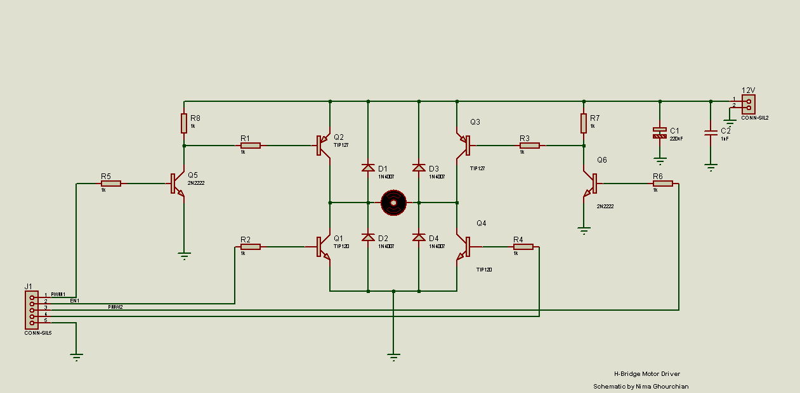

## Project Overview

An H-bridge allows a DC motor to rotate in either direction without manually swapping its wires. By selecting different conduction paths through the bridge, the circuit reverses the direction of current through the motor.

The project involved assembling the physical circuit, testing its operation with a DC motor, and documenting the circuit in Proteus.

## How It Works

An H-bridge places the motor between two switching branches. Each motor terminal can be connected toward either the positive supply or ground through the bridge.

- **One direction:** Current flows from the positive supply, through one side of the bridge, across the motor, and back through the opposite side.
- **Reverse direction:** The opposite conduction path reverses the polarity across the motor, changing its direction of rotation.

The exact clockwise or counterclockwise direction depends on how the motor terminals are connected.

The upper and lower switches in the same branch must not conduct simultaneously, as this creates a direct path between the supply and ground, known as shoot-through.

## Breadboard Implementation

The circuit was assembled on a breadboard using real components and successfully tested with a DC motor.

The breadboard build provided practical experience with motor-driver wiring, power connections, and troubleshooting a physical circuit.

## Circuit Schematic

The schematic was drawn in Proteus to document the circuit connections.

To inspect the editable schematic, download the repository and open `H-Bridge-Motor-Driver.pdsprj` in Proteus.

## Repository Contents

| File | Description |
|---|---|
| `H-Bridge-Motor-Driver.pdsprj` | Editable Proteus circuit project |
| `H-Bridge-DC-Motor-Driver.bmp` | Exported schematic image |
| `H-Bridge Breadboard.jpg` | Photograph of the physical breadboard implementation |

